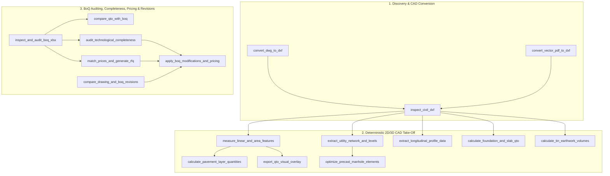

# civil-qto-mcp

[](https://github.com/LacziAS/civil-qto-mcp/actions/workflows/ci.yml)
[](LICENSE)
[](https://www.python.org/)
[](https://modelcontextprotocol.io/)
[](tests/)

**Deterministic Model Context Protocol (MCP) Server for Civil Engineering, Roadworks, Paving, Earthworks, Foundations & Utilities Quantity Take-Off (`.dxf` / `.dwg` / `.pdf`) and Bill of Quantities (`.xlsx` / `.xlsm`) Auditing.**

---

## Why `civil-qto-mcp`?

Vision LLMs and naive text-dump scripts fail on real-world civil engineering drawings and construction budgets:
- **Real CAD drawings are messy:** Inconsistent layer names, exploded `LINE`/`ARC` segments, overlapping duplicate lines (`OVERKILL` not run), unclosed polygons with $2\text{–}8\text{ cm}$ gaps, 3D "Flying Z" elevation snaps on 2D plans, mirrored OCS entities (`extrusion Z = -1`), and mismatched `$INSUNITS` headers on national grid coordinates (such as **UTM / ETRS89**, **Gauss-Krüger**, **UK OSGB36**, **US State Plane**, or Hungarian **EOV / HD72 EPSG:23700**).
- **Real Excel BoQs contain traps:** Hidden internal calculation worksheets, hidden alternative rows, split Material + Labor + Equipment columns (**TERC / ÉNGY**, **DIN VOB/C**, or **CESMM4** layouts), hardcoded numbers overwriting live formulas, and incomplete `=SUM(...)` ranges.

`civil-qto-mcp` bridges AI agents (**Claude Code**, **Claude Desktop**, **Cursor**, **Antigravity**) with **exact C++ computational geometry (`Shapely 2.0` / `GEOS` + `ezdxf`)** and **exact `Decimal` spreadsheet auditing (`openpyxl`)**, governed by a **3-Step Human-in-the-Loop (HITL)** engineering workflow:



---

## Complete Tool Reference (v0.5.0 – 17 Deterministic Tools)

| # | Tool Name | Category | Purpose & Engineering Guarantees |
| :-: | :--- | :---: | :--- |
| 1 | **`inspect_civil_dxf`** | CAD Discovery | Lists Modelspace layers (ignoring Paperspace layouts) from `.dxf` or `.dwg` files, extracts `INSERT` block names, `ATTRIB` tag names, and cleaned `TEXT`/`MTEXT` samples. Performs 3-factor CRS & unit scale estimation and flags CAD hygiene issues. |
| 2 | **`measure_linear_and_area_features`** | 2D QTO | Measures linear features ($\text{m}$) with analytical circular arc (`bulge`) calculation, 2D horizontal projection ($Z \equiv 0$), and 1D `Shapely` overlap deduplication. Measures net surface areas ($\text{m}^2$) via 2D boolean `.difference()` (preventing double-deduction on perforated `HATCH`es) with configurable **VOB/C (DIN 18318)** minimum island deduction thresholds (`min_island_deduction_m2`). |
| 3 | **`extract_utility_network_and_levels`** | Utilities | Extracts manholes/gullies (`INSERT`, `CIRCLE`, box `LWPOLYLINE`) and utility pipes. Matches Cover (`CL`/`OK`/`F`) and Invert (`IL`/`S`/`Ff`) levels across `EN`/`DE`/`HU` profiles in priority order: (1) `insert.attribs` (`ATTRIB`), (2) `LEADER` arrow tip tracing, (3) `STRtree` spatial proximity. Calculates **DIN 4124 / EN 1610** trench excavation, bedding/pipe-zone, pipe displacement, and backfill volumes ($\text{m}^3$). |
| 4 | **`inspect_and_audit_boq_xlsx`** | BoQ Audit | Safely parses `.xlsx` and `.xlsm` BoQs while **strictly excluding `hidden` / `veryHidden` worksheets and hidden rows**. Supports 1-column, 2-column (Material+Labor), and 3-column (Labor+Material+Equipment) layouts, `keyword_filter` + `limit`/`offset` pagination, and audits 100% of visible rows for `MATH_MISMATCH`, `HARDCODED_TOTAL`, `SUM_RANGE_GAP`, `SHARED_FORMULA_RISK`, and `ZERO_UNIT_PRICE`. |
| 5 | **`compare_qto_with_boq`** | Cross-Check | Deterministically cross-checks CAD QTO quantities against Excel BoQ items with built-in international construction unit synonym & scale conversion (`m` $\leftrightarrow$ `fm`/`lm`/`lfm`/`km`/`ft`/`yd`, `m2` $\leftrightarrow$ `nm`/`sqm`/`ha`/`sqft`, `m3` $\leftrightarrow$ `lm3`/`bm3`/`cum`/`cy`, `pcs` $\leftrightarrow$ `ea`/`nr`/`st`/`stk`/`db`/`akna`/`ls`). |
| 6 | **`convert_dwg_to_dxf`** | CAD Loader | Batch-converts `.dwg` files (or directories of `.dwg` files) to `.dxf` with SHA-256 content caching and binary AutoCAD header detection (`AC1015`..`AC1032`) via AutoCAD Core Console (`accoreconsole`), ODA File Converter, or LibreDWG. |
| 7 | **`optimize_precast_manhole_elements`** | Utilities | Decomposes manholes (`DN1000`/`DN1200`/`48"`) and $50\times 50\text{ cm}$ road gullies into optimal precast concrete modules across **DIN EN 1917**, **ASTM C478**, and **SzeBeton T2** catalogs (`AFE` base, `ASZ` cone or shallow `AFT` flat cover slab, `AGY` 100/75/50/25 cm shaft rings, `SZB` 10/8/6 cm adjustment rings, and `D400` covers) and builds a consolidated manufacturer RFQ Bill of Materials (BOM). |
| 8 | **`calculate_pavement_layer_quantities`** | Roadworks | Calculates multi-layer road and paving structural quantities ($\text{m}^2$, compacted $\text{m}^3$, order $\text{m}^3$, and metric tons $\text{t}$) accounting for lateral step-out widening beyond curb lines, compaction multipliers (e.g., `CBM / CKT-4` $\times 1.20$), and cutting/overlap waste (**EN 13108 / EN 13285 / EN 14227**). |
| 9 | **`convert_vector_pdf_to_dxf`** | PDF Import | Imports vector PDF engineering drawings into layered DXF files via AutoCAD Core Console (`_-PDFIMPORT`) and automatically calibrates `recommended_scale_factor_to_meters` from reference dimensions, explicit scale ratios, or title-block scale texts (`M=1:250`, `Scale 1:500`). |
| 10 | **`extract_longitudinal_profile_data`** | Utilities | Parses utility longitudinal profile (`EN` / `DE` / `HU` station bands: `Ground Level`/`Geländehöhe`/`Terepszint`, `Invert`/`Sohlhöhe`/`Csőfenék`, `Station`/`Stationierung`/`Szelvény`) to calculate trench excavation, machine vs. hand excavation split at utility crossings, two-sided shoring area ($\ge 1.25\text{ m}$), and shallow-cover ($<1.00\text{ m}$) `C12/15` concrete encasement volumes ($\text{m}^3$). |
| 11 | **`apply_boq_modifications_and_pricing`** | BoQ Writer | Safely writes unit prices (with optional `markup_factor` and currency-safe `round_step`), red-bold quantity modifications, supplemental items (`SUPPLEMENTAL_ITEM` / `K_TETEL`), and `-`/`+` variation order pairs (`VARIATION_PAIR` / `KIV_ESZREVETEL_PAIR`) into Excel BoQ workbooks while updating `SUM` ranges, populating XML `<v>` cached values, and stripping `xl/calcChain.xml`. |
| 12 | **`export_qto_visual_overlay`** | Visual QA | Exports an interactive standalone `.html` and `.svg` visual verification map (`locale="en" \| "de" \| "hu"`) highlighting all measured net surface polygons, deducted islands, linear features, and point nodes with their exact $\text{m}^2$ / $\text{m}$ quantities. |
| 13 | **`audit_technological_completeness`** | Completeness | Scans BoQ workbooks against 6 civil engineering technological completeness chains (asphalt, block paving, gravity sewers, pressure water lines, RC foundations, industrial slabs) to detect omitted companion items (missing curbs, tack coat, tie-in saw-cutting, manhole cover count mismatches, shallow pipe concrete encasement, slab joints) and outputs ready-to-insert supplemental items. |
| 14 | **`calculate_foundation_and_slab_qto`** | Structures | Calculates the complete structural and earthwork quantity chain for pad footings, cup footings, strip foundations, plinth walls, raft slabs, and industrial floors: structural concrete ($\text{m}^3$), blinding concrete with $+10\text{ cm}$ lateral overhang ($\text{m}^3$), lateral formwork ($\text{m}^2$), rebar/fiber tonnage ($\text{t}$), **DIN 4124** prismoidal pit excavation ($\text{m}^3$), plinth XPS insulation ($\text{m}^2$), and saw-cut contraction joints ($\text{m}$). |
| 15 | **`match_prices_and_generate_rfq`** | Pricing & RFQ | Matches BoQ line items against 3-tier regional unit-price databases (own historical DB, supplier price lists, and built-in benchmarks), flags transport-sensitive items, generates ready-to-apply `BoQRowPricingInput` payloads, and groups materials into 6 procurement RFQ packages with regional supplier contacts. |
| 16 | **`calculate_tin_earthwork_volumes`** | 3D Earthworks | Computes 3D Delaunay TIN surface earthwork volumes (`topsoil_strip_volume_m3`, `cut_volume_bank_m3`, `fill_volume_compacted_m3`, and `net_earth_balance_m3`) between existing terrain and designed subgrade level (accounting for pavement structure thickness offset and zero-line `nullvonal` sub-triangle integration) directly from CAD spot-elevation layers or 3D point clouds without Civil 3D. |
| 17 | **`compare_drawing_and_boq_revisions`** | Revisions | Compares Old (`R0` / Design) vs. New (`R1` / As-Built) CAD drawings and/or BoQ Excel workbooks, reporting spatial polygon additions/removals (`New - Old` and `Old - New`), linear/point deltas, row-level BoQ diffs, and ready-to-insert variation order payloads. |

---

## Quick Start & Installation

### 1. Claude Code CLI (`claude mcp add`)

```bash
claude mcp add civil-qto -- uvx civil-qto-mcp
```

### 2. Claude Desktop / Cursor / Antigravity (`mcp_config.json`)

```json
{
  "mcpServers": {
    "civil-qto": {
      "command": "uvx",
      "args": ["civil-qto-mcp"]
    }
  }
}
```

### 3. Run from Local Source Repository

```json
{
  "mcpServers": {
    "civil-qto": {
      "command": "uv",
      "args": [
        "--directory",
        "/path/to/civil-qto-mcp",
        "run",
        "civil-qto-mcp"
      ]
    }
  }
}
```

---

## Development & Automated Testing

All 35 geometric, structural, earthwork, and spreadsheet edge cases are tested deterministically using programmatic synthetic DXF (`tests/factories/dxf_factory.py`) and XLSX (`tests/factories/xlsx_factory.py`) generators—requiring zero proprietary client drawings in CI.

```bash
# Install dependencies including dev tools
uv sync --extra dev

# Run Ruff linter
uv run ruff check src tests

# Run Pytest test suite (35 tests across v0.1..v0.5)
uv run pytest -v
```

---

## License

Released under the [MIT License](LICENSE). Copyright (c) 2026 András Sándor Laczi.
